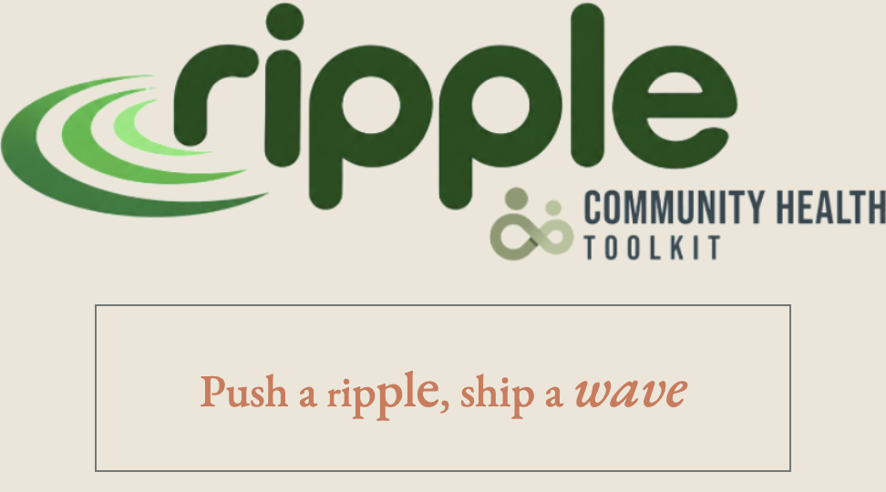
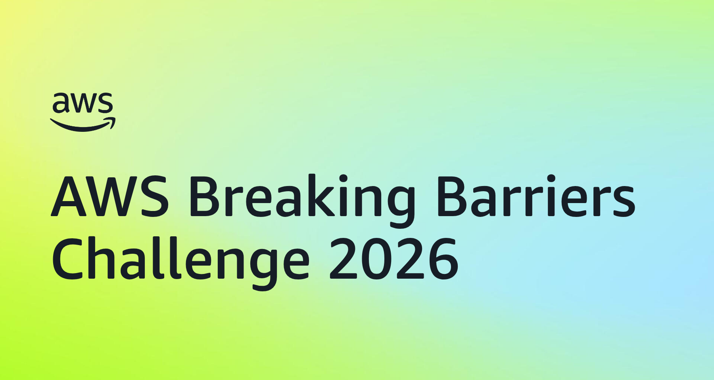
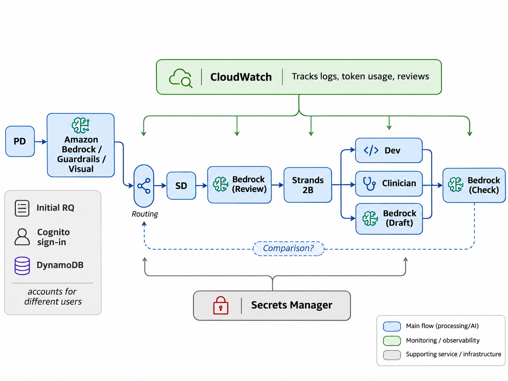

# Ripple

**Push a ripple, ship a wave.**






Ripple is a hackathon prototype for turning a product owner's request and public guideline evidence into reviewable [Community Health Toolkit (CHT)](https://communityhealthtoolkit.org/) configuration. Use public guidelines and synthetic patient data for the demo.

## How Ripple works



*Concept sketch for intake, routing, and review. The steps below describe the implemented request-to-release flow.*

1. **Submit and confirm.** A product owner signs in through Amazon Cognito and submits a request. The integrated app saves the revision in DynamoDB, screens it with Amazon Bedrock and Guardrails, and generates a preview when screening passes. The owner confirms that exact preview to start the downstream workflow.
2. **Draft and check.** A worker loads the pinned guideline and independently reviewed golden cases for the selected pathway and baseline. Bedrock proposes the pathway logic, and a deterministic checker compares it with the golden cases. The timeline shows blockers such as missing evidence or a failed check.
3. **Approve, build, and verify.** A clinician reviews the checked draft in the app. Once approved, the build runner compiles it into a CHT package and verifies the build against the same pinned golden cases.
4. **Release and download.** A separate release approver reviews the verified build. After approval, the product owner can download the exact package version that was approved.

## Startup guide


Use Node.js 22.18 or later. Run the commands below from the repository root.

| What you want to test | Start here | Where the request goes |
| --- | --- | --- |
| Browser UI without AWS | [Fixture demo](#1-browser-demo-without-aws) on port 3197 | Synthetic sign-in, screening, preview, and confirmation |
| Real Cognito and Bedrock screening | [Standalone intake](#2-standalone-intake-with-aws) on port 3000 | Confirmation saves a queued handoff |
| Clinical approval, build, verification, and download | [Integrated AWS app](#3-full-workflow-in-the-aws-sandbox) on port 8080 | The worker picks up confirmed requests and advances them through release |

### 1. Browser demo without AWS

```sh
npm ci
node packages/ui/test/test-server.js
```

Open [http://127.0.0.1:3197](http://127.0.0.1:3197). Sign in with the demo flow, submit a synthetic request, then screen, preview, and confirm it. The fixture server clears its requests when it restarts.

### 2. Standalone intake with AWS

Configure the standalone Cognito pool and client, intake table and bucket, AWS credentials, and baseline registry in your local `.env`. To run screening, enable it and configure the permitted Bedrock model and published guardrail. The Cognito callback must match the local app URL. [Standalone intake setup](packages/intake/README.md#run-locally-against-aws)

```sh
npm ci
npm start
```

Open [http://localhost:3000](http://localhost:3000) and sign in as a product owner. Submit a request, choose **Screen this revision**, then create and confirm the preview. **Queued** is the final state in this mode. A clinician sign-in cannot start the handoff.

### 3. Full workflow in the AWS sandbox

The integrated app needs the provisioned sandbox, its running build runner, the Terraform `integrated_app_environment` settings, and a baseline registry and curated evidence catalog. The catalog ties a pathway and baseline to a versioned guideline and golden cases. Set up the app host and deploy the app and runner before forwarding the port. [Integrated app deployment and evidence catalog](docs/integrated-pipeline.md)

After preparing the environment file and registry and catalog directory, start the integrated image on the app host. Set `APP_IMAGE` to the published image tag from deployment.

```sh
docker run --init --detach --restart unless-stopped --name cht-nocode-app \
  --env-file /etc/cht-nocode/integrated-app.env \
  --mount type=bind,src=/etc/cht-nocode/integrated-config,dst=/config,readonly \
  --publish 127.0.0.1:8080:8080 "$APP_IMAGE"
```

Once the integrated app is running, use the AWS CLI and Session Manager plugin to forward port 8080. Run this from a Terraform checkout that can read the sandbox outputs.

```sh
APP_HOST_ID="$(terraform -chdir=infra/terraform output -raw app_host_instance_id)"
aws ssm start-session --region us-west-2 --target "$APP_HOST_ID" \
  --document-name AWS-StartPortForwardingSession \
  --parameters '{"portNumber":["8080"],"localPortNumber":["8080"]}'
```

Keep the session open and go to [http://localhost:8080](http://localhost:8080).

1. Sign in as a **product owner** in the shared Cognito pool. Submit a fresh synthetic request with a pathway and baseline from the catalog. Screening and preview generation run automatically.
2. Click **Confirm this exact revision**. The worker starts drafting and checking. A clinician account is needed when the timeline reaches **Awaiting clinical approval**.
3. In a separate browser session, sign in as the **clinician** and approve from the review inbox. The worker starts the build and verification.
4. After verification passes, sign in as a **separate release approver**. Review the evidence and approve release. The product owner can now choose **Download approved package**.

Requests previously confirmed in standalone intake need a migration before the integrated worker can process them. Use a fresh request for the sandbox smoke test.

### Run the automated checks locally

```sh
npm ci
npm test -w packages/intake -w packages/ui
```

With Docker running, start DynamoDB Local and run the request-to-release test. It uses recorded model responses and simulated build stages, so it runs without AWS credentials.

```sh
docker compose -f docker-compose.test.yml up -d
R2_DYNAMODB_LOCAL_ENDPOINT=http://127.0.0.1:8000 \
  npm run test:pipeline -w packages/orchestrator
docker compose -f docker-compose.test.yml down
```

## Section guides

| Section | What it owns |
| --- | --- |
| [UI](packages/ui/README.md) | Guideline library, sign-in, request editing, and revision tracking |
| [Intake](packages/intake/README.md) | Request validation, screening, confirmation, and queued handoff |
| [Drafter](packages/drafter/README.md) | Guideline extraction, Bedrock proposals, and citation checks |
| [Orchestrator](packages/orchestrator/README.md) | Workflow state, reviews, approvals, and job reconciliation |
| [Schema](packages/schema/README.md) | Shared logic, golden-case, and worker contracts |
| [Evaluator](packages/evaluator/README.md) | Deterministic interpretation of pathway logic |
| [Checker](packages/checker/README.md) | Structural findings, golden-case comparison, and overlap checks |
| [Compiler](packages/compiler/README.md) | CHT project generation from a logic snapshot |
| [Synthetic patients](packages/synth/README.md) | Boundary inputs and branch coverage |
| [Verification](packages/verification/README.md) | Compiled behavior, expected outcomes, and verification reports |
| [Build runner](runner/README.md) | Queued job execution, leases, and artifact storage |
| [Build image](build-image/README.md) | CHT conversion and verification toolchain |
| [Infrastructure](infra/README.md) | Terraform, AWS resources, and host bootstrap |
| [Scripts](scripts/README.md) | Deployment, local support, and smoke tests |
