# DesignBrief eligibility gate and Routing Box

Run fictional unit tests without installing dependencies:

```sh
cd /Users/vivi/Documents/Codex/2026-11-03/hel/work/packages/orchestrator
npm test
```

Runtime tests were verified with Node.js v24.18.0. Static checking is configured
separately with TypeScript 5.9.3 and Node.js 22 type definitions. Running the tests
on the team's actual Node.js 22 runtime remains a separate verification step.
No shared configuration was changed.

## Static TypeScript checking

After the team-approved dependency installation, run from this package:

```sh
npm run typecheck
npm test
```

The package declares exact development-only versions of `typescript` (5.9.3) and
`@types/node` (22.20.1). These are tooling dependencies, not AWS integrations.
The standalone `tsconfig.json` checks all `src/**/*.ts` and `test/**/*.ts` files
without extending the empty shared root configuration. It enables `strict`, uses
NodeNext ESM resolution, ES2022 language/library definitions and Node 22 APIs,
allows the existing `.ts` import extensions, and restricts TypeScript syntax to
erasable forms compatible with Node's type stripping. `noEmit` prevents generated
JavaScript. Library declaration files are checked too; `skipLibCheck` is not enabled.
This does not replace runtime validation of untrusted data or authorization.

For the initial verification, the pinned compiler and Node 22 types were installed
in an isolated directory under `/private/tmp`, with no repository `node_modules`
or lockfile created. The compiler's `.bin` directory was temporarily added to
`PATH`, and `npm run typecheck -- --typeRoots <tool-directory>/node_modules/@types`
selected those exact Node types. No machine-specific paths are saved in the config.
That temporary tool installation is not a reproducible team dependency installation;
plain `npm run typecheck` needs the declared development dependencies available.

The repository has an empty root `package.json`, an empty `pnpm-workspace.yaml`,
and no lockfile. pnpm currently fails on the empty root manifest. Agree on the
package manager/version, shared lockfile owner, and workspace installation process
before installing dependencies in the repository. Do not create a package-local
npm lockfile as a substitute for an agreed team workspace lockfile.

## Ownership and input contract

All contracts in `src/routing.ts` are provisional and local to this package.
Initial AI screening and the intake UI belong to other workstreams. This module
only validates their evidence and computes a decision.

`routeDesignBrief(input)` accepts an internal `RoutingInput` envelope containing:

- `currentRevision`: the authoritative current `requestId`, `revision`, and
  `snapshotHash`, loaded independently of the submitted evidence.
- `currentScreeningId`: the authoritative selected screening attempt.
- `brief`: the same identity plus `title`, `objective`, `targetPopulation`, and
  condition/action `requirements`.
- `screening`: the same identity, `screeningId`, status (`PENDING`, `COMPLETED`,
  or `FAILED`), and all five assessment areas: `completeness`, `ambiguities`,
  `contradictions`, `clinicalSafety`, and `feasibility`.
- `confirmation`: the same identity, `confirmationId`, the applicable
  `screeningId`, and a decision (`CONFIRMED` or `REVISION_REQUESTED`).

Each screening area has an `outcome` and explicit `reasons` array:

- `CLEAR` requires an empty reasons array.
- `NEEDS_REVIEW` requires at least one non-empty unresolved concern.
- `NOT_ASSESSED` blocks eligibility, even if screening says `COMPLETED`.

Unknown assessment areas/outcomes or inconsistent outcome/reason combinations
block eligibility. Input is expected to be ordinary JSON data, not executable
objects or proxies. IDs are non-empty strings without outer whitespace. Revision
numbers are positive safe integers. Hashes must be 64 lowercase hexadecimal digits.

## Eligibility before routing

| Result | Meaning |
| --- | --- |
| `NOT_READY` | Missing, malformed, stale, failed, incomplete, unconfirmed, or conflicting evidence. Do not create a Service Designer task. |
| `NEEDS_SD_REVIEW` | Prerequisites are valid and current, but completed screening reports concerns or local structural checks find missing workflow content or contradictory actions. |
| `READY_FOR_BEDROCK_REVIEW` | Prerequisites are valid and current, all five checks are clear, and local structural checks find no concerns. |

Invalid prerequisites take precedence over concerns: a clinical finding plus a
missing PO confirmation is `NOT_READY`, not an automatically created SD task.

Results include the current revision identity, evidence record IDs, structured
reason codes/field locations/messages, and `clinicalApprovalRequired: true`.
Missing/invalid identity fields are returned as `null`; no IDs or hashes are invented.
An evidence ID in a blocked result is diagnostic, not proof the evidence was accepted.

The function creates no queues, jobs, state transitions, model calls, or audit
writes. A returned route never automatically starts downstream review. Future
workflow code must explicitly decide and record the next action.

## Trust and snapshot identity

This is NOT an endpoint accepting browser-provided proof. Future server code must
load current pointers, screening, and PO confirmation from authoritative storage,
authenticate who may write them, and validate model output before recording a
completed screening. Matching hashes alone do not establish authenticity.
A browser `trusted: true` flag is not evidence. This pure module cannot enforce
authentication, verify the actual snapshot bytes, or discover omitted records.

The brief, screening, and PO confirmation must all match the authoritative current
identity exactly. Confirmation must reference the selected screening attempt.
Even mutually consistent old evidence fails if the authoritative current revision
has advanced. Multiple candidate records are not accepted in place of a selected
record; future storage code must resolve the authoritative attempt explicitly.

Production hashing is not implemented. The schema and intake teammates must agree
on canonical snapshot serialization and hash coverage. Tests use fixed fictional
64-character fingerprints. Initial screening must cover the final proposed snapshot
shown to the PO. Any content edit needs a new revision, screening, and confirmation.
Records should remain immutable; finding resolution must not erase old concerns.

## Clinical safety and limitations

Preliminary AI screening and PO confirmation are not clinical approval. Bedrock
Guardrails safety controls are also distinct from substantive screening.
Service Designers may clarify workflow requirements but cannot waive clinical
approval. Any clinical safety concern needs appropriate human clinical review
before final release. Independent clinician approval, developer verification,
and release approval remain mandatory later, including when all AI checks are clear.
The result's constant clinical-approval requirement is a reminder, not an implemented
approval gate; later workflow/authentication/storage code must enforce it and preserve
clinical concern history across revisions.

Local checks retain required workflow fields and same-condition/different-action
conflict detection. Whitespace is normalized for comparisons, but case is preserved
so identifiers such as `fieldA` and `fielda` are not silently equated. The router
cannot understand clinical prose or prove feasibility or semantic consistency.
Reported concerns are preserved with their assessment field and message.

## Integration decisions still needed

Agree the provisional field names, positive revision numbering, hash format and
canonical snapshot coverage; the selected-screening pointer and retry policy;
how PO identities and permissions are recorded; and finding resolution/clinical
escalation ownership. The shared-schema owner controls any eventual shared types.
Storage placeholders remain under `src/storage`; no storage package is created.

The pure `workflow.ts` transition function described below consumes routing results
without treating a route as an approval or starting external work.

## Pure authoritative workflow (provisional R2 milestone)

`src/workflow.ts` exports `transitionWorkflow(state, event)`. Pass `null` and a
`SUBMIT` event to create a workflow. It returns `ACCEPTED`, `REJECTED`, or
`DUPLICATE`, a new state (or the unchanged state), and a proposed audit event.
Events and stored state are internal backend contracts, not browser payloads.

```mermaid
stateDiagram-v2
    [*] --> WAITING_FOR_SCREENING: PO SUBMIT
    WAITING_FOR_SCREENING --> WAITING_FOR_PO_CONFIRMATION: R3 SCREENING_COMPLETED
    WAITING_FOR_PO_CONFIRMATION --> READY_TO_ROUTE: owning PO confirms exact preview
    WAITING_FOR_PO_CONFIRMATION --> RETURNED_FOR_CLARIFICATION: PO requests corrections
    READY_TO_ROUTE --> READY_TO_ROUTE: NOT_READY rejected; no advancement
    READY_TO_ROUTE --> NEEDS_SD_REVIEW: apply eligible SD route
    READY_TO_ROUTE --> READY_FOR_LOGIC_PROPOSAL: apply eligible AI route
    NEEDS_SD_REVIEW --> WAITING_FOR_SCREENING: SD revises request
    READY_FOR_LOGIC_PROPOSAL --> DRAFTING_LOGIC: explicit START_LOGIC_PROPOSAL
    DRAFTING_LOGIC --> WAITING_FOR_LOGIC_CHECKS: R3 LOGIC_PROPOSED
    WAITING_FOR_LOGIC_CHECKS --> WAITING_FOR_CLINICAL_APPROVAL: R4 checks pass
    WAITING_FOR_CLINICAL_APPROVAL --> CLINICALLY_APPROVED: independent clinician approves LogicModel
    CLINICALLY_APPROVED --> COMPILING: explicit START_COMPILATION
    COMPILING --> WAITING_FOR_VERIFICATION: R5 returns bound artifact
    WAITING_FOR_VERIFICATION --> VERIFYING: explicit START_VERIFICATION
    VERIFYING --> WAITING_FOR_RELEASE_APPROVAL: R6 passes compiled artifact
    WAITING_FOR_RELEASE_APPROVAL --> RELEASE_APPROVED: independent release decision
    RELEASE_APPROVED --> DOWNLOAD_READY: explicit MAKE_DOWNLOAD_AVAILABLE
    WAITING_FOR_CLINICAL_APPROVAL --> RETURNED_FOR_CLARIFICATION: clinician returns with note
    WAITING_FOR_RELEASE_APPROVAL --> RETURNED_FOR_CLARIFICATION: release reviewer returns with note
    WAITING_FOR_CLINICAL_APPROVAL --> REJECTED: clinician rejects with note
    WAITING_FOR_RELEASE_APPROVAL --> REJECTED: release reviewer rejects with note
    WAITING_FOR_LOGIC_CHECKS --> FAILED: checks fail
    VERIFYING --> FAILED: verification fails
    COMPILING --> FAILED: compiler FAIL event
    DRAFTING_LOGIC --> FAILED: drafter FAIL event
    WAITING_FOR_SCREENING --> FAILED: screening worker FAIL event
    RETURNED_FOR_CLARIFICATION --> WAITING_FOR_SCREENING: request revision
    RETURNED_FOR_CLARIFICATION --> WAITING_FOR_LOGIC_CHECKS: LogicModel revision when one exists
    REJECTED --> WAITING_FOR_LOGIC_CHECKS: new LogicModel revision
    FAILED --> WAITING_FOR_SCREENING: new request revision
```



The diagram shows the main paths. `FAIL` also applies while waiting for R4 checks
and during verification. Any owning-PO request revision resets all later evidence,
including after download readiness. An R3 LogicModel revision, once a model exists,
returns to checks and clears clinical approval and all build/release evidence.
A request revision can also recover a rejected request. Recovery is deliberately
conservative: this version has no same-input retry or approval-waiver command.
An applicable new content revision is required to recover from a stopped state.

### State meanings

| States | What they mean |
| --- | --- |
| `WAITING_FOR_SCREENING`, `WAITING_FOR_PO_CONFIRMATION` | Waiting for R3 screening, then the owning PO's interpretation confirmation. Neither grants clinical approval. |
| `READY_TO_ROUTE`, `NEEDS_SD_REVIEW`, `READY_FOR_LOGIC_PROPOSAL` | Evaluate the existing router result; retain concerns for an SD or permit an explicit proposal-start command. `NOT_READY` is a rejected transition, not SD work. |
| `DRAFTING_LOGIC`, `WAITING_FOR_LOGIC_CHECKS` | R3 prepares a LogicModel; R4 checks that exact model revision and hash. |
| `WAITING_FOR_CLINICAL_APPROVAL`, `CLINICALLY_APPROVED` | A clinician independent of contributors reviews the exact checked model. Approval unlocks a separate compilation-start command. |
| `COMPILING`, `WAITING_FOR_VERIFICATION`, `VERIFYING` | Track a compile attempt and actual artifact, then a distinct verification run with a version-bound report. |
| `WAITING_FOR_RELEASE_APPROVAL`, `RELEASE_APPROVED`, `DOWNLOAD_READY` | A separate release approver accepts the exact passing artifact/report; a separate command marks availability. No actual URL or download is created. |
| `RETURNED_FOR_CLARIFICATION`, `REJECTED`, `FAILED` | Progress is stopped. Reviewer returns/rejections require notes; worker failures record the stopped stage. Applicable revisions restart the required checks. |

### Identity, approval and revision guards

- Every event includes the current request ID, preview revision, snapshot hash,
  an event ID, actor, and expected workflow state version. Initial revision is 1.
- R3 screening and owning-PO confirmation bind to that exact preview and screening
  attempt. Screening validation reuses the router with an internal validation-only
  confirmation placeholder. That placeholder is never recorded as confirmation;
  only an accepted owning-PO `PO_DECISION` supplies the real record.
- `APPLY_ROUTING` consumes the existing `RoutingResult` and compares it to the
  existing router's result over the stored records. It does not reimplement the
  routing checks. `NOT_READY` leaves state unchanged; no SD task is created.
- LogicModel identity has a separate positive `logicRevision` and SHA-256
  `logicHash`. R4 checks and clinician approval bind to both. Request confirmation
  does not approve a LogicModel. Compilation requires current successful checks
  and matching clinical approval.
- Compile results bind to the active `compilationId`, approved LogicModel, and
  `artifactHash`. Verification binds to that artifact, the active `verificationId`,
  and a `reportHash`. Only explicit boolean `passed: true` permits release review.
- Release approval binds to the complete passing verification evidence. Download
  readiness rechecks release, clinical, and artifact bindings. No live deployment
  is modeled or authorized.
- The PO, designer, drafter, checker, compiler, and verifier contributors are
  tracked by actor ID across revisions. Contributors cannot clinically approve
  their own work. The compiler cannot be the clinical approver; the verifier
  cannot be the compiler or clinical approver. The release approver must be
  independent of contributors and the clinical approver, even with multiple roles.
- A new request revision invalidates screening, PO confirmation, routing, model,
  checks, approvals, and artifact evidence. A new LogicModel revision preserves
  request confirmation but clears checks, clinical approval, and all later evidence.
  Changed content requires the next revision number and a different valid hash.
  Late callbacks retain old identities and cannot advance the revised workflow.

### Audit, duplicates and concurrency

Accepted transitions propose audit events with actor, command type, reason/note,
before/after states, workflow version, attempted/current request identity, current
model identity, and artifact hash. Rejected attempts also propose an audit record
and return the unchanged state. No audit is written, and no timestamp is generated;
the eventual backend must supply authoritative time and append-only persistence.

Accepted event IDs are recorded with deterministic canonical JSON fingerprints.
An identical repeated event returns `DUPLICATE` without another advancement,
even after later revisions. Reusing an event ID for different content is rejected.
This fingerprint is an event receipt, not a generated snapshot/content hash.
Rejected IDs are not recorded as accepted receipts; rejected attempts can be retried
and must be audited by the backend. Receipts are kept in state for this local MVP;
durable storage should manage them atomically with workflow updates.

`expectedVersion` rejects stale commands, but this pure function cannot serialize
concurrent callers. A future conditional write/transaction must atomically save
the new state, event receipt, and audit. Never launch work from a speculative
transition before the state update succeeds.

### Trust boundary and remaining integrations

Mock test identities are not authentication. The backend must resolve actor IDs,
roles, resource access, contributor provenance, and module callbacks itself.
It must load authoritative state/evidence and verify stored content against the
agreed hashes. Hash matching here cannot prove that clinical content was correct,
that a test really ran, or that bytes match the claimed hash. R4 schema validation
and R6 real compiled-behavior evidence remain essential.

- R1: display these states; submit bound PO decisions and corrections; display only
  backend-authorized downloadable artifacts.
- R3: supply the screened final preview and structured LogicModel proposals with
  their identities; preserve unresolved findings.
- R4: confirm shared contracts, canonical hash coverage/serialization, model
  revisions, and successful deterministic checker evidence.
- R5: return immutable compiled artifact identity for the approved model and run.
- R6: return independent synthetic verification with artifact, model, run, and
  report identities plus an explicit pass/fail result.
- R7: later supply identity infrastructure and transactional state/audit storage;
  coordinate real service identities, permissions, and delivery/retry mechanics.

Next: agree canonical snapshot contracts with R4 and implement small pure snapshot
helpers with fixtures. Then add a storage interface with conditional state updates
and a local fake, before exposing clinician/release approval APIs that resolve
actors and evidence on the server. Same-input job retry policy, production retention,
actual download access and link invalidation remain later integration work.
