# DesignBrief eligibility gate and Routing Box

Run fictional unit tests without installing dependencies:

```sh
cd /Users/vivi/Documents/Codex/2026-11-03/hel/work/packages/orchestrator
npm test
```

Runtime tests were verified with Node.js v24.18.0. Static checking is configured
separately with TypeScript 5.9.3 and Node.js 22 type definitions. Running the tests
on the team's actual Node.js 22 runtime remains a separate verification step.
No shared configuration was changed.

## Static TypeScript checking

Run from this package with its declared dependencies installed (see the package-only
installation notes in the snapshot section below):

```sh
npm run typecheck
npm test
```

The package declares exact development-only versions of `typescript` (5.9.3) and
`@types/node` (22.20.1). These are tooling dependencies, not AWS integrations.
The standalone `tsconfig.json` checks all `src/**/*.ts` and `test/**/*.ts` files
without extending the empty shared root configuration. It enables `strict`, uses
NodeNext ESM resolution, ES2022 language/library definitions and Node 22 APIs,
allows the existing `.ts` import extensions, and restricts TypeScript syntax to
erasable forms compatible with Node's type stripping. `noEmit` prevents generated
JavaScript. Library declaration files are checked too; `skipLibCheck` is not enabled.
This does not replace runtime validation of untrusted data or authorization.

For the initial verification, the pinned compiler and Node 22 types were installed
in an isolated directory under `/private/tmp`, with no repository `node_modules`
or lockfile created. The compiler's `.bin` directory was temporarily added to
`PATH`, and `npm run typecheck -- --typeRoots <tool-directory>/node_modules/@types`
selected those exact Node types. No machine-specific paths are saved in the config.
That temporary tool installation was not a reproducible team dependency installation.
The snapshot milestone below now installs the declared dependencies locally, allowing
plain `npm run typecheck` to run without temporary PATH/typeRoots overrides.

The repository has an empty root `package.json`, an empty `pnpm-workspace.yaml`,
and no lockfile. pnpm currently fails on the empty root manifest. Agree on the
package manager/version, shared lockfile owner, and workspace installation process
before a normal workspace installation. The isolated package-only installation below
does not change the shared files. Do not create a package-local
npm lockfile as a substitute for an agreed team workspace lockfile.

## Ownership and input contract

All contracts in `src/routing.ts` are provisional and local to this package.
Initial AI screening and the intake UI belong to other workstreams. This module
only validates their evidence and computes a decision.

`routeDesignBrief(input)` accepts an internal `RoutingInput` envelope containing:

- `currentRevision`: the authoritative current `requestId`, `revision`, and
  `snapshotHash`, loaded independently of the submitted evidence.
- `currentScreeningId`: the authoritative selected screening attempt.
- `brief`: the same identity plus `title`, `objective`, `targetPopulation`, and
  condition/action `requirements`.
- `screening`: the same identity, `screeningId`, status (`PENDING`, `COMPLETED`,
  or `FAILED`), and all five assessment areas: `completeness`, `ambiguities`,
  `contradictions`, `clinicalSafety`, and `feasibility`.
- `confirmation`: the same identity, `confirmationId`, the applicable
  `screeningId`, and a decision (`CONFIRMED` or `REVISION_REQUESTED`).

Each screening area has an `outcome` and explicit `reasons` array:

- `CLEAR` requires an empty reasons array.
- `NEEDS_REVIEW` requires at least one non-empty unresolved concern.
- `NOT_ASSESSED` blocks eligibility, even if screening says `COMPLETED`.

Unknown assessment areas/outcomes or inconsistent outcome/reason combinations
block eligibility. Input is expected to be ordinary JSON data, not executable
objects or proxies. IDs are non-empty strings without outer whitespace. Revision
numbers are positive safe integers. Hashes must be 64 lowercase hexadecimal digits.

## Eligibility before routing

| Result | Meaning |
| --- | --- |
| `NOT_READY` | Missing, malformed, stale, failed, incomplete, unconfirmed, or conflicting evidence. Do not create a Service Designer task. |
| `NEEDS_SD_REVIEW` | Prerequisites are valid and current, but completed screening reports concerns or local structural checks find missing workflow content or contradictory actions. |
| `READY_FOR_BEDROCK_REVIEW` | Prerequisites are valid and current, all five checks are clear, and local structural checks find no concerns. |

Invalid prerequisites take precedence over concerns: a clinical finding plus a
missing PO confirmation is `NOT_READY`, not an automatically created SD task.

Results include the current revision identity, evidence record IDs, structured
reason codes/field locations/messages, and `clinicalApprovalRequired: true`.
Missing/invalid identity fields are returned as `null`; no IDs or hashes are invented.
An evidence ID in a blocked result is diagnostic, not proof the evidence was accepted.

The function creates no queues, jobs, state transitions, model calls, or audit
writes. A returned route never automatically starts downstream review. Future
workflow code must explicitly decide and record the next action.

## Trust and snapshot identity

This is NOT an endpoint accepting browser-provided proof. Future server code must
load current pointers, screening, and PO confirmation from authoritative storage,
authenticate who may write them, and validate model output before recording a
completed screening. Matching hashes alone do not establish authenticity.
A browser `trusted: true` flag is not evidence. This pure module cannot enforce
authentication, verify the actual snapshot bytes, or discover omitted records.

The brief, screening, and PO confirmation must all match the authoritative current
identity exactly. Confirmation must reference the selected screening attempt.
Even mutually consistent old evidence fails if the authoritative current revision
has advanced. Multiple candidate records are not accepted in place of a selected
record; future storage code must resolve the authoritative attempt explicitly.

Production hashing is not implemented. The schema and intake teammates must agree
on canonical snapshot serialization and hash coverage. Tests use fixed fictional
64-character fingerprints. Initial screening must cover the final proposed snapshot
shown to the PO. Any content edit needs a new revision, screening, and confirmation.
Records should remain immutable; finding resolution must not erase old concerns.

## Clinical safety and limitations

Preliminary AI screening and PO confirmation are not clinical approval. Bedrock
Guardrails safety controls are also distinct from substantive screening.
Service Designers may clarify workflow requirements but cannot waive clinical
approval. Any clinical safety concern needs appropriate human clinical review
before final release. Independent clinician approval, developer verification,
and release approval remain mandatory later, including when all AI checks are clear.
The result's constant clinical-approval requirement is a reminder, not an implemented
approval gate; later workflow/authentication/storage code must enforce it and preserve
clinical concern history across revisions.

Local checks retain required workflow fields and same-condition/different-action
conflict detection. Whitespace is normalized for comparisons, but case is preserved
so identifiers such as `fieldA` and `fielda` are not silently equated. The router
cannot understand clinical prose or prove feasibility or semantic consistency.
Reported concerns are preserved with their assessment field and message.

## Integration decisions still needed

Agree the provisional field names, positive revision numbering, hash format and
canonical snapshot coverage; the selected-screening pointer and retry policy;
how PO identities and permissions are recorded; and finding resolution/clinical
escalation ownership. The shared-schema owner controls any eventual shared types.
Storage placeholders remain under `src/storage`; no storage package is created.

The pure `workflow.ts` transition function described below consumes routing results
without treating a route as an approval or starting external work.

## Pure authoritative workflow (provisional R2 milestone)

`src/workflow.ts` exports `transitionWorkflow(state, event)`. Pass `null` and a
`SUBMIT` event to create a workflow. It returns `ACCEPTED`, `REJECTED`, or
`DUPLICATE`, a new state (or the unchanged state), and a proposed audit event.
Events and stored state are internal backend contracts, not browser payloads.

```mermaid
stateDiagram-v2
    [*] --> WAITING_FOR_SCREENING: PO SUBMIT
    WAITING_FOR_SCREENING --> WAITING_FOR_PO_CONFIRMATION: R3 SCREENING_COMPLETED
    WAITING_FOR_PO_CONFIRMATION --> READY_TO_ROUTE: owning PO confirms exact preview
    WAITING_FOR_PO_CONFIRMATION --> RETURNED_FOR_CLARIFICATION: PO requests corrections
    READY_TO_ROUTE --> READY_TO_ROUTE: NOT_READY rejected; no advancement
    READY_TO_ROUTE --> NEEDS_SD_REVIEW: apply eligible SD route
    READY_TO_ROUTE --> READY_FOR_LOGIC_PROPOSAL: apply eligible AI route
    NEEDS_SD_REVIEW --> WAITING_FOR_SCREENING: SD revises request
    READY_FOR_LOGIC_PROPOSAL --> DRAFTING_LOGIC: explicit START_LOGIC_PROPOSAL
    DRAFTING_LOGIC --> WAITING_FOR_LOGIC_CHECKS: R3 LOGIC_PROPOSED
    WAITING_FOR_LOGIC_CHECKS --> WAITING_FOR_CLINICAL_APPROVAL: R4 checks pass
    WAITING_FOR_CLINICAL_APPROVAL --> CLINICALLY_APPROVED: independent clinician approves LogicModel
    CLINICALLY_APPROVED --> COMPILING: explicit START_COMPILATION
    COMPILING --> WAITING_FOR_VERIFICATION: R5 returns bound artifact
    WAITING_FOR_VERIFICATION --> VERIFYING: explicit START_VERIFICATION
    VERIFYING --> WAITING_FOR_RELEASE_APPROVAL: R6 passes compiled artifact
    WAITING_FOR_RELEASE_APPROVAL --> RELEASE_APPROVED: independent release decision
    RELEASE_APPROVED --> DOWNLOAD_READY: explicit MAKE_DOWNLOAD_AVAILABLE
    WAITING_FOR_CLINICAL_APPROVAL --> RETURNED_FOR_CLARIFICATION: clinician returns with note
    WAITING_FOR_RELEASE_APPROVAL --> RETURNED_FOR_CLARIFICATION: release reviewer returns with note
    WAITING_FOR_CLINICAL_APPROVAL --> REJECTED: clinician rejects with note
    WAITING_FOR_RELEASE_APPROVAL --> REJECTED: release reviewer rejects with note
    WAITING_FOR_LOGIC_CHECKS --> FAILED: checks fail
    VERIFYING --> FAILED: verification fails
    COMPILING --> FAILED: compiler FAIL event
    DRAFTING_LOGIC --> FAILED: drafter FAIL event
    WAITING_FOR_SCREENING --> FAILED: screening worker FAIL event
    RETURNED_FOR_CLARIFICATION --> WAITING_FOR_SCREENING: request revision
    RETURNED_FOR_CLARIFICATION --> WAITING_FOR_LOGIC_CHECKS: LogicModel revision when one exists
    REJECTED --> WAITING_FOR_LOGIC_CHECKS: new LogicModel revision
    FAILED --> WAITING_FOR_SCREENING: new request revision
```



The diagram shows the main paths. `FAIL` also applies while waiting for R4 checks
and during verification. Any owning-PO request revision resets all later evidence,
including after download readiness. An R3 LogicModel revision, once a model exists,
returns to checks and clears clinical approval and all build/release evidence.
A request revision can also recover a rejected request. Recovery is deliberately
conservative: this version has no same-input retry or approval-waiver command.
An applicable new content revision is required to recover from a stopped state.

### State meanings

| States | What they mean |
| --- | --- |
| `WAITING_FOR_SCREENING`, `WAITING_FOR_PO_CONFIRMATION` | Waiting for R3 screening, then the owning PO's interpretation confirmation. Neither grants clinical approval. |
| `READY_TO_ROUTE`, `NEEDS_SD_REVIEW`, `READY_FOR_LOGIC_PROPOSAL` | Evaluate the existing router result; retain concerns for an SD or permit an explicit proposal-start command. `NOT_READY` is a rejected transition, not SD work. |
| `DRAFTING_LOGIC`, `WAITING_FOR_LOGIC_CHECKS` | R3 prepares a LogicModel; R4 checks that exact model revision and hash. |
| `WAITING_FOR_CLINICAL_APPROVAL`, `CLINICALLY_APPROVED` | A clinician independent of contributors reviews the exact checked model. Approval unlocks a separate compilation-start command. |
| `COMPILING`, `WAITING_FOR_VERIFICATION`, `VERIFYING` | Track a compile attempt and actual artifact, then a distinct verification run with a version-bound report. |
| `WAITING_FOR_RELEASE_APPROVAL`, `RELEASE_APPROVED`, `DOWNLOAD_READY` | A separate release approver accepts the exact passing artifact/report; a separate command marks availability. No actual URL or download is created. |
| `RETURNED_FOR_CLARIFICATION`, `REJECTED`, `FAILED` | Progress is stopped. Reviewer returns/rejections require notes; worker failures record the stopped stage. Applicable revisions restart the required checks. |

### Identity, approval and revision guards

- Every event includes the current request ID, preview revision, snapshot hash,
  an event ID, actor, and expected workflow state version. Initial revision is 1.
- R3 screening and owning-PO confirmation bind to that exact preview and screening
  attempt. Screening validation reuses the router with an internal validation-only
  confirmation placeholder. That placeholder is never recorded as confirmation;
  only an accepted owning-PO `PO_DECISION` supplies the real record.
- `APPLY_ROUTING` consumes the existing `RoutingResult` and compares it to the
  existing router's result over the stored records. It does not reimplement the
  routing checks. `NOT_READY` leaves state unchanged; no SD task is created.
- LogicModel identity has a separate positive `logicRevision` and SHA-256
  `logicHash`. R4 checks and clinician approval bind to both. Request confirmation
  does not approve a LogicModel. Compilation requires current successful checks
  and matching clinical approval.
- Compile results bind to the active `compilationId`, approved LogicModel, and
  `artifactHash`. Verification binds to that artifact, the active `verificationId`,
  and a `reportHash`. Only explicit boolean `passed: true` permits release review.
- Release approval binds to the complete passing verification evidence. Download
  readiness rechecks release, clinical, and artifact bindings. No live deployment
  is modeled or authorized.
- The PO, designer, drafter, checker, compiler, and verifier contributors are
  tracked by actor ID across revisions. Contributors cannot clinically approve
  their own work. The compiler cannot be the clinical approver; the verifier
  cannot be the compiler or clinical approver. The release approver must be
  independent of contributors and the clinical approver, even with multiple roles.
- A new request revision invalidates screening, PO confirmation, routing, model,
  checks, approvals, and artifact evidence. A new LogicModel revision preserves
  request confirmation but clears checks, clinical approval, and all later evidence.
  Changed content requires the next revision number and a different valid hash.
  Late callbacks retain old identities and cannot advance the revised workflow.

### Audit, duplicates and concurrency

Accepted transitions propose audit events with actor, command type, reason/note,
before/after states, workflow version, attempted/current request identity, current
model identity, and artifact hash. Rejected attempts also propose an audit record
and return the unchanged state. No audit is written, and no timestamp is generated;
the eventual backend must supply authoritative time and append-only persistence.

Accepted event IDs are recorded with deterministic canonical JSON fingerprints.
An identical repeated event returns `DUPLICATE` without another advancement,
even after later revisions. Reusing an event ID for different content is rejected.
This fingerprint is an event receipt, not a generated snapshot/content hash.
Rejected IDs are not recorded as accepted receipts; rejected attempts can be retried
and must be audited by the backend. Receipts are kept in state for this local MVP;
durable storage should manage them atomically with workflow updates.

`expectedVersion` rejects stale commands, but this pure function cannot serialize
concurrent callers. A future conditional write/transaction must atomically save
the new state, event receipt, and audit. Never launch work from a speculative
transition before the state update succeeds.

### Trust boundary and remaining integrations

Mock test identities are not authentication. The backend must resolve actor IDs,
roles, resource access, contributor provenance, and module callbacks itself.
It must load authoritative state/evidence and verify stored content against the
agreed hashes. Hash matching here cannot prove that clinical content was correct,
that a test really ran, or that bytes match the claimed hash. R4 schema validation
and R6 real compiled-behavior evidence remain essential.

- R1: display these states; submit bound PO decisions and corrections; display only
  backend-authorized downloadable artifacts.
- R3: supply the screened final preview and structured LogicModel proposals with
  their identities; preserve unresolved findings.
- R4: confirm shared contracts, canonical hash coverage/serialization, model
  revisions, and successful deterministic checker evidence.
- R5: return immutable compiled artifact identity for the approved model and run.
- R6: return independent synthetic verification with artifact, model, run, and
  report identities plus an explicit pass/fail result.
- R7: later supply identity infrastructure and transactional state/audit storage;
  coordinate real service identities, permissions, and delivery/retry mechanics.

Next: agree canonical snapshot contracts with R4 and implement small pure snapshot
helpers with fixtures. Then add a storage interface with conditional state updates
and a local fake, before exposing clinician/release approval APIs that resolve
actors and evidence on the server. Same-input job retry policy, production retention,
actual download access and link invalidation remain later integration work.

## Provisional snapshot hashing

`src/snapshots.ts` provides `createSnapshot(draft, validator)`, `canonicalizeJson`,
and separate `requestPreviewIdentity` / `logicModelIdentity` projections. It uses
pinned `canonicalize@3.0.0` (Apache-2.0), an implementation listed by RFC 8785,
and Node's built-in SHA-256. There is no handwritten key/number canonicalizer.

A snapshot is a copied, recursively frozen JSON object:

```json
{
  "kind": "LOGIC_MODEL",
  "requestId": "fictional-001",
  "revision": 1,
  "schemaVersion": "1.0",
  "hashPolicyVersion": "jcs-sha256-v1",
  "requestPreview": {
    "requestId": "fictional-001",
    "revision": 2,
    "snapshotHash": "<64 lowercase hex digits from the preview snapshot>"
  },
  "content": { "schemaVersion": "1.0", "...": "entire LogicModel" },
  "snapshotHash": "<computed SHA-256, not a caller-provided value>"
}
```

The angle-bracket values are explanatory placeholders, not executable fixtures.
A `REQUEST_PREVIEW` snapshot has the same base metadata but no `requestPreview`
reference. `revision` is the revision of that snapshot kind: a model revision is
not the same counter as the request preview revision. The model must reference a
preview for the same request. This code validates the reference's structure; the
future backend must establish that the referenced preview exists and is current.

Hash policy `jcs-sha256-v1` hashes UTF-8 RFC 8785 canonical JSON of the **entire
snapshot envelope except its own `snapshotHash` field**. It includes kind, request
ID, revision, schema version, hash-policy identifier, full content, and the model's
preview reference. Metadata changes therefore change the hash even when clinical
content stays the same. Object key ordering does not change it. Array order is
preserved, including question order and first-match decision-table rows.

All supplied JSON content is included: sources, citations, source hashes/URLs,
condition trees, outcomes, ambiguities, and optional visualization/extension data.
No content fields are selected away. A computed hash is an integrity fingerprint,
not proof of validation correctness, clinician approval, or release authorization.
Artifact identity remains separate; no compiled-artifact hashing is implemented.
The workflow and router are unchanged and continue to use their existing identity
contracts through the projections. Store the complete snapshot, not just its hash
or the reduced workflow fields.

The strict JSON-domain layer rejects undefined, functions, symbols, bigint,
non-finite numbers, lone Unicode surrogates in keys/values, sparse/decorated arrays,
cycles, non-plain objects, hidden properties, accessors, and proxies. It does not
invoke `toJSON` or normalize strings. It copies and freezes input before validation,
so changing the caller's original content cannot silently change a hashed snapshot.
Validators must be synchronous, return no transformed content, and throw to reject.

RFC 8785 uses ECMAScript IEEE-754 number serialization: `-0` and `0` canonicalize
to the same number, and equivalent representable numeric values have the same
hash. Unicode normalization is not performed: composed and decomposed spellings
remain distinct. Numbers requiring exact precision beyond IEEE-754 should use an
R4-agreed representation, such as validated decimal strings. Hashing cannot recover
precision already lost before the function received a JavaScript number.

Input is already-parsed JSON data, not JSON source text. A JavaScript object cannot
represent duplicate keys; a future raw JSON ingestion boundary must reject duplicate
keys and numeric tokens that violate R4's precision policy **before** normal parsing
would discard information. This milestone does not implement that parser.

`SnapshotError` reports `INVALID_JSON`, `INVALID_METADATA`, or `SCHEMA_REJECTED`.
Unknown metadata, caller-provided hashes/policy identifiers, and a missing validator
are rejected. Unknown JSON content extensions are retained and hashed by the
provisional adapter; their admissibility belongs to the final R4 schema.

### Pending Role 4 Integration

Reference reviewed: [R5 LogicModel v1 proposal on compiler branch](https://github.com/skootzs/MedicalMobile---AWS-Hackathon/blob/compiler/packages/compiler/docs/logic-model-v1-proposal.md),
Git blob `d6d5721f83053b9f3582090d33b2507cfa3cf3ff`. It explicitly identifies itself
as a draft, with R4 as schema owner. No compiler or schema files were changed.

`provisionalSnapshotValidator` checks only basic preview fields, or the proposal's
model version/title/pathway/language, required arrays, and one decision table.
It does **not** check reference integrity, AST constructs, question ordering,
completeness, ambiguity resolutions, clinical semantics, or compiler compatibility.
It must not be described as complete LogicModel validation. A caller must explicitly
supply this adapter or an R4 replacement to `createSnapshot`; there is no implicit
validation-success default. The full frozen content goes to the adapter, and schema
integration can change without rewriting the workflow state machine.

R4/team agreement is still needed on:

- Official versioned schemas for previews, models, sources/citations, and ambiguities,
  including required/unknown fields and runtime validation behavior.
- Exact hash envelope and coverage, especially metadata and the originating preview.
  A change in hash rules requires a new hash-policy identifier and compatibility plan.
- JCS/UTF-8/SHA-256 agreement, numeric precision/ranges, Unicode policy, and strict
  raw JSON parsing responsibilities.
- Model versus preview revision numbering and rules for schema upgrades and migrations.
- Cross-module golden snapshots with expected canonical bytes and hashes, plus R4
  checks proving the model supplied to reviewers is what the compiler consumes.

### Local dependency installation for this milestone

The snapshot dependency and existing pinned dev tools are installed only in this
package's ignored `node_modules`. The install explicitly used `--workspaces=false`,
`--package-lock=false`, and `--ignore-scripts`; no root/shared configuration or
repository lockfile was changed. `npm run typecheck` and `npm test` now work directly
from this package. The earlier temporary typecheck tool directory is not required.
This local installation does not decide the team's package manager or lockfile
ownership. Normal workspace installation and reproducible locked CI remain pending.
Do not run a default root install against the empty root manifest.

Next: finalize R4's contract, then define a snapshot repository with immutable writes,
hash verification on load, and atomic workflow/event/audit updates. Test it with a
local fake before adding authenticated approval APIs. No database, API, AWS adapter,
Strands Box, or real review job has been added here.

## Provisional storage and audit contracts (R2)

`src/storage/requests.ts` defines the replaceable async `OrchestratorStore`:

- `apply(command, principal)` is the only write operation. A command includes the
  request ID, a server-assigned `attemptId`, an actor-free workflow event, and any
  new immutable snapshots needed by that transition.
- `getWorkflow` loads the current state/version. Versioned request content is kept
  in immutable preview snapshots; this fake does not store a separate historical
  workflow state for every version.
- `getSnapshot` and `listSnapshots` retrieve verified immutable snapshot history.
- `getReceipt`, `listEvidence`, and `listAudit` expose copied historical records.

There is no public `setState`, `putApproval`, snapshot-overwrite, or audit-update
method. `artifacts.ts` defines accepted evidence history for screening, PO
confirmation, R4 checks, clinical decisions, compiled artifact references,
verification evidence, and release decisions. A reviewer rejection/return is an
accepted decision event but does not become an approval. Only artifact/report references are stored. The adapter adds no patient/profile,
credential, name, or email fields and does not retain principal context.
Pseudonymous actor IDs and required decision notes remain in records. Only public
or fictional workflow data belongs here; no automatic PHI detector is implemented.

### How it interacts with the workflow

```text
Internal backend command + principal context
  -> resolve actor through injected trusted-backend boundary
  -> read the latest stored workflow version
  -> transitionWorkflow(currentState, eventWithResolvedActor)
  -> verify required preview / LogicModel snapshots and immutable evidence IDs
  -> atomically publish state + snapshots + evidence + receipt + audit
  -> return ACCEPTED / REJECTED / DUPLICATE (or throw on storage failure)
```

The adapter calls the existing pure transition function rather than accepting a
caller-supplied next state. All existing routing, role separation, revision, clinical
approval, verification, and release guards remain there. `NOT_READY` cannot advance
state or create SD work. No review jobs, compilation, URLs, or other external actions
are triggered by a committed route or transition.

The event's `expectedVersion` is the conditional-update guard; submission expects
version 0, each accepted transition increments it once, and rejected/duplicate
attempts leave it unchanged. After awaiting actor resolution, the fake reads the
latest version and performs all remaining work synchronously without another await.
It builds replacement Maps and publishes them with one pointer assignment. Two
concurrent continuations therefore cannot both consume the same version in this
single JavaScript process. That is **not** a distributed database transaction.

### Snapshot and evidence integrity

The adapter reconstructs snapshots through `createSnapshot` and the injected schema
validator, compares hashes and policy versions, and verifies the requested storage
slot on write and load. Stored bytes are immutable canonical JSON strings; loads
also reject byte changes that JSON parsing alone could discard, such as duplicate keys. A preview must contain
exactly the workflow brief's content (excluding its identity fields), and its hash
must match the brief. A current model needs an existing matching LogicModel
snapshot linked to that exact preview. There is no acceptance of invented model
hashes simply because they have 64 hexadecimal digits.

Preview slots are `(requestId, REQUEST_PREVIEW, revision)`. LogicModel slots also
include the originating preview identity because the existing workflow restarts
LogicModel revision numbering at 1 after a request revision. R4 must confirm this
scope before shared integration. A different snapshot cannot replace an occupied
slot; supplying identical bytes is harmless. Bundled snapshots must belong to the
same request and the resulting current preview/model, so a transition cannot insert
unrelated or orphan snapshot history.

Workflow and receipt reads reverify their referenced preview. Workflow reads also
check the current LogicModel; historical evidence reads verify referenced preview
and model snapshots. Artifact and verification records contain version-bound IDs and
hash references only. This milestone cannot prove actual artifact/report bytes or
real test execution: those remain R5/R6/backend responsibilities. Audit reads return
historical diagnostics, including rejected attempts whose claimed references may
intentionally be missing or invalid.

Current state is returned as a deep copy. Loaded snapshots are rebuilt and frozen.
Evidence, receipts and audits are copied on return, so mutating a returned object
cannot change stored records. Old evidence and approvals remain in history after
revisions, while the current state's applicable approvals are invalidated by the
workflow. Reusing an immutable evidence ID for another event is rejected.

### Idempotency, audit and rollback

`eventId` identifies a workflow command; `attemptId` identifies an application
attempt/audit entry. Both are scoped to the request:

- An accepted event stores one receipt containing the workflow fingerprint,
  resulting version, request identity, and original audit ID.
- Repeating the same attempt with identical content and resolved actor returns the
  original result with `replayed: true`, without another write. Its original
  ACCEPTED response does not mean a second transition occurred.
- The same event under a fresh attempt returns `DUPLICATE` and appends a duplicate
  audit entry without another state advancement, snapshot, evidence record or receipt.
  Snapshot attachments on non-accepted events are not written.
- Changing event content under an accepted event ID is rejected and audited.
  Changing content under an existing attempt ID throws `ATTEMPT_ID_REUSED`; its
  existing audit is never overwritten. A new attempt ID is required for new work.
- Workflow rejections, unauthorized attempts, and snapshot/evidence conflicts append
  only a rejection audit when a valid request/attempt scope and functioning storage
  are available. They do not change workflow state, evidence, receipts or snapshots.

`audit.ts` defines append-only records extending the workflow's proposed audit with
an audit ID, per-request sequence and backend timestamp. A backend clock is used,
not a browser timestamp. No update/delete audit operation is exposed. The fake keeps
attempt fingerprints privately for replay detection; these are not snapshot hashes.

All writes are staged before commit. If the clock or final commit fails, none of
that transaction's state, evidence, snapshots, receipt or audit is saved. Snapshot
schema/hash failures also cannot leave partly saved content. A rejection audit can
be the deliberate sole result of a blocked operation; that is not a partially saved
accepted transition. Some failures cannot be audited here: missing request/attempt
IDs, uncloneable commands, attempt-ID collisions, corrupted stored snapshots, or a
failed audit/commit operation. A future backend needs a separate operational failure
log for these cases and must never report success when its transaction failed.

### Trust boundary and fake limitations

`InMemoryOrchestratorStore` requires `resolveActor(principal, requestId)` and
`validateSnapshot`. There is no default trusted actor. The event cannot carry an
`actor`; the adapter injects the resolved backend identity and then applies workflow
role/independence guards. It rejects caller-supplied next-state or approval fields
on the command envelope. Principal context is not retained. An unresolved identity
gets a rejection result without a workflow version disclosure.

The resolver is a **dependency boundary, not implemented authentication**. Tests
map fictional strings to mock actors. Never expose that mapping as HTTP auth.
Production must authenticate sessions/service callers, enforce request-level access,
validate callback provenance and R4 schemas, and resolve real authorized roles.
Reads are internal repository methods and must also sit behind backend authorization.
An authorized module's callback still needs server verification that its referenced
checks/artifacts/reports really exist and are authoritative. A database adapter alone
cannot establish clinical truth or trustworthy provenance.

The fake is process-local, volatile, unbounded, and intended for fictional tests.
Restarting loses all data; separate instances do not coordinate. It has no durable
persistence, distributed locks/transactions, encryption configuration, pagination,
production retention, or real access controls. Optional `testFaults` hooks simulate
commit failures/corrupt read bytes solely for tests; they are not part of the
`OrchestratorStore` interface and must not be exposed in production.

### Pending Role 4 Integration — storage

Confirm shared event/evidence schemas, schema-version dispatch for historical
snapshots, preview/model revision scope, immutable evidence ID uniqueness, and
hash coverage before adopting these contracts outside this package. The current
snapshot adapter remains shape-only. Existing router/workflow/snapshot modules and
all their original tests are preserved.

Next: review this milestone, then add an application command service for clinician
and release decisions that loads the exact snapshots/evidence, resolves authenticated
actors, and calls `apply` with expected versions. Test that service locally before
adding Fastify handlers. Coordinate a durable adapter with R7 that preserves atomic
conditional updates across state, receipts, evidence and append-only audit; never
run downstream work until the transaction succeeds. No cloud, API, Cognito,
DynamoDB, S3, Strands Box, deployment or database implementation is added here.

## Application service and version-bound human decisions

`src/approvals.ts` exports `ApprovalService.execute(command, principal)` and a
provisional `ApprovalCommand`. This is an internal application service, not an HTTP
endpoint. It coordinates stored evidence and existing workflow guards; it does not
implement authentication, generate clinical logic, or perform clinical validation.

Both clinical/content and release commands contain `requestId`, `eventId`,
`expectedVersion`, the exact request preview revision/hash, the LogicModel
revision/hash, a decision (`APPROVE`, `REJECT`, or `RETURN`), and an optional note.
Rejections/returns require a non-empty note. Clinical commands name the R4 checker
report ID. Release commands additionally name the clinical approval event,
compilation ID, artifact hash, verification ID and verification-report hash.
R1 should obtain these references from an authorized backend review view, rather
than asking a reviewer to type hashes manually.

The command schema rejects unknown fields, including actor IDs, roles, `trusted`,
`passed`, or server-only guard properties. Hashes and revisions are references to
check, not proof that a review/test passed. The service loads snapshots and accepted
evidence through `OrchestratorStore`; it never accepts a verification document or
passing flag supplied in the reviewer command as authoritative.

```text
Typed reviewer command + opaque backend principal context
  -> injected request-scoped identity provider
  -> load current workflow, verified snapshots and immutable evidence
  -> match request/model/checker/clinical/artifact/verification references
  -> preflight with the existing transitionWorkflow function
  -> store.apply with expected version and resolved-actor binding
  -> store re-resolves identity and runs current workflow guards
  -> atomically save state, receipt, decision record and audit
```

Role permissions, contributor independence, permitted states, and approval gates
remain in `workflow.ts`. The service reuses that function for preflight and the
store invokes it again over the latest state. The additional service checks bind
references to actual accepted ledger records. A successful R4 report must be an
unambiguous stored `LOGIC_CHECKED` event with literal boolean `passed: true` and
the exact request and model identity. A string such as `"true"` is not success.
A computed snapshot hash, PO confirmation or preliminary screening cannot satisfy
this check or substitute for clinical approval.

For release, the service also checks the current clinical approval and its accepted
reviewer decision, compiler evidence, and current passing R6 verification record.
The workflow then enforces a separate authorized release approver and blocks
contributors or the clinician from granting release approval. A clinical decision
cannot approve a stale LogicModel, and a release decision cannot approve another
artifact or report. New model/request revisions continue to invalidate approvals
through the unchanged workflow implementation.

### Small storage contract additions

Three optional internal `ApplyCommand` fields support this boundary:

- `expectedActorId` binds commit to the actor resolved during service preflight.
  A different identity at commit is rejected. The store still resolves current
  roles itself, so losing the clinician role before commit also blocks approval.
- `preconditionFailure` records a service validation failure as a rejection audit
  without advancing state. It can only reject; it never grants permission.
- `commandFingerprint` is SHA-256 of canonical JSON for the complete validated
  application command, including evidence references that are not workflow-event
  fields. It is stored on the accepted event receipt and detects event-ID reuse
  with altered checker/clinical/verification references. This is not a snapshot or
  artifact hash, and it does not establish approval authority.

These fields are generated by backend service code and are not allowed in the
reviewer command. A real storage adapter must enforce the same semantics. Existing
commands/receipts without an application fingerprint retain their existing behavior;
a new application command cannot claim such a receipt as its own accepted event.

The service uses a backend-generated attempt ID (`randomUUID` by default) for each
call; tests can inject deterministic unique IDs. Exact accepted retries load the
original immutable decision event and return a duplicate even after later content
revisions. They do not restore old approvals or advance the new revision. Changing
a command under the same accepted event ID is rejected. Same-attempt storage replay
also creates no extra audit/decision. New attempts at the same event can append a
DUPLICATE audit without duplicating the approval record.

### Structured results and failures

Results contain request/event IDs, a reason code, workflow version, audit ID when
recorded, and a replay marker, with one of:

| Status | Meaning |
| --- | --- |
| `SUCCESS` | The human decision was recorded. This includes explicit REJECT/RETURN, not just approval. Inspect the decision and resulting state. |
| `REJECTED` | Invalid command, unauthorized/independent-review failure, missing or incompatible evidence, or event-ID reuse. |
| `STALE_VERSION` | Workflow version, request snapshot, LogicModel or artifact reference is outdated; reload the review view. |
| `DUPLICATE_EVENT` | An already accepted identical decision was recognized, without another transition or approval record. |
| `STORAGE_FAILURE` | Reading, integrity verification, audit/commit, or another storage operation failed; do not report approval success. |

Well-formed rejected decisions are submitted through storage as rejected attempts,
so they append audit records without changing authorized state or evidence. Invalid
command shapes return rejection before storage and have no audit ID. Read failures
or broken receipt history may likewise prevent recording an audit. The eventual
HTTP/backend layer needs operational logging for those cases. Failure results do
not claim that audit recording succeeded.

Optimistic concurrency is the final protection against changes between asynchronous
service reads and commit. The fake's atomic update publishes all records together,
and injected failures leave no partial approval/audit/receipt. The application
service itself does not supply distributed transactions or durability.

### Authentication, schema and integration limits

The service and store must use the same trusted, request-scoped identity source.
The provider must authenticate session/service context and authorize access to the
request before returning only the required actor ID/roles. Fictional string-to-actor
mappings exist only in test fixtures and must never become browser authentication.
The store re-resolves at commit; a provider failure or mismatched identity cannot
fall back to granting approval. Real authentication remains pending; the local HTTP milestone below adds an
injected request-access boundary, with access denied by default.

Stored R4/R5/R6 events are authoritative only within the backend trust boundary.
Real integration must authenticate callbacks and verify the actual reports and
artifact bytes. The current R4 validation adapter remains provisional/shape-only;
checker compatibility here means exact accepted report/model bindings, not proof of
clinical correctness or a complete R4 evaluator implementation.

All new application contracts remain local until R4 confirms shared schemas for
commands, checker/verification evidence, schema versions, and audit/idempotency
metadata. The in-memory store remains process-local and volatile. This application-service milestone added no database, Cognito, Bedrock, AWS
or Strands Box integration. The following milestone supplies the local HTTP adapter.

Next: add a thin Fastify adapter around this service with explicit request/response
schemas and injected authentication. Derive principal context from server-verified
sessions, pass only permitted reviewer fields, and map service outcomes to clear
HTTP responses. Test routes with `inject()` using fictional providers first; never
accept actor/role/trusted flags from the body or public headers as authentication.
Coordinate a durable adapter and request-scoped identity integration with R7 before
exposing the service publicly.


## Local Fastify API (provisional, test-only)

`createLocalApi()` in `src/server.ts` wraps the existing ApprovalService and store.
It exposes only `inject()` and `close()`: no public listener, `listen()` method,
raw server, or start script is provided. All business guards still belong to the
existing service/workflow/store; the HTTP layer validates and translates messages.

| Route | Purpose |
| --- | --- |
| `GET /api/requests/:requestId/status` | Read an accessible request's status and current version only. |
| `POST /api/requests/:requestId/clinical-decisions` | Record APPROVE, REJECT, or RETURN for exact checked clinical/content LogicModel evidence. |
| `POST /api/requests/:requestId/release-decisions` | Record APPROVE, REJECT, or RETURN for exact compiled/verified artifact evidence. |

The POST body is the existing application command without `type` or `requestId`:
the server derives those from the route. Common fields are `eventId`,
`expectedVersion`, `requestRevision`, `requestSnapshotHash`, `logicRevision`,
`logicHash`, `decision`, and optional `note`. REJECT/RETURN require a nonblank note.
Clinical decisions also require `checkerReportId`. Release decisions instead require
`clinicalApprovalEventId`, `compilationId`, `artifactHash`, `verificationId`, and
`verificationReportHash`. These are references, never authoritative evidence supplied
by the client: ApprovalService loads and checks backend records.

### Authentication and validation

`AuthenticationBoundary` is injected server code with `authenticate()` and
`canAccessRequest()`. Omitted authentication denies every request. Authentication
establishes an opaque principal before body parsing; request access is checked before
handler storage/service calls. The service/store must resolve that context through
the same trusted identity source. Role and independence checks remain in the service
and workflow. The only mock session mapping is under `test/helpers/api-fixtures.ts`;
no source file imports it. It has no production security value.

Actor IDs, roles, trusted flags, evidence-authority fields, body request IDs and
command types are rejected as unexpected body properties. Spoofed actor/role headers
do not authenticate anyone. Input validation does not coerce values, remove unknown
fields or insert defaults. Provisional transport limits: 32 KiB body, identifiers
1–100 characters without leading/trailing whitespace, positive safe revision
integers, nonnegative safe expected versions, lowercase 64-character SHA-256 strings,
and notes up to 2,000 characters. Unknown query parameters are rejected. Responses
use explicit schemas, generic infrastructure errors, and `Cache-Control: no-store`.

### Response semantics

| HTTP | Meaning |
| --- | --- |
| 200 | Decision recorded, or identical previously accepted event recognized; GET returns status/version. |
| 400 | Malformed JSON, invalid/missing field or unexpected property. |
| 401 | No verified principal. |
| 403 | Authenticated actor fails decision role or reviewer-independence rules. |
| 404 | Request absent or inaccessible; same generic response for both. |
| 409 | Stale version, conflicting event or incompatible/missing approval evidence. |
| 503 | Authentication/access provider or storage/infrastructure failure; no internal exception details. |

A successful POST returns `reviewType`, `decision`, `decisionRecorded: true`,
`outcome: DECISION_RECORDED`, `duplicate: false`, `workflowVersion`, `auditId`, and
request/event IDs. A recorded REJECT or RETURN is a successful decision submission,
not approval. There is no `approvalGranted` flag or download permission in this
response. Clinical approval alone never authorizes release.

An exact retry returns 200 with `outcome: DUPLICATE_EVENT` and `duplicate: true`.
It does not repeat a transition or decision record; a distinct attempt may append
a DUPLICATE audit entry under the existing service semantics. Reusing an accepted
event ID with a changed command returns 409. A retry after later revisions acknowledges
the original event and never reactivates old approval. Read current status separately.
Malformed/unauthenticated/resource-denied HTTP attempts are blocked before the service
and do not receive durable audit entries; operational security logging is still pending.

### Fictional examples

An authorized injected GET `/api/requests/fictional-001/status` returns 200:

```json
{"requestId":"fictional-001","status":"WAITING_FOR_CLINICAL_APPROVAL","version":7}
```

A clinical POST to `/api/requests/fictional-001/clinical-decisions` in the existing
fictional test fixture uses hashes computed from its immutable snapshots:

```json
{
  "eventId": "http-clinical-7",
  "expectedVersion": 7,
  "requestRevision": 1,
  "requestSnapshotHash": "0de6a9d3c1fb64bc258d9252c371c2faa5639f39858ef32b155346727402b952",
  "logicRevision": 1,
  "logicHash": "b8da115e6b0ab7e04e56dcb9d4d1167e2b34a481c7c5a0dcbdbd87f22aa103f1",
  "checkerReportId": "checks-6",
  "decision": "APPROVE"
}
```

With the fictional clinician context and deterministic test attempt ID, it returns:

```json
{
  "requestId": "fictional-001",
  "eventId": "http-clinical-7",
  "reviewType": "CLINICAL_CONTENT",
  "decision": "APPROVE",
  "outcome": "DECISION_RECORDED",
  "decisionRecorded": true,
  "duplicate": false,
  "workflowVersion": 8,
  "auditId": "[\"fictional-001\",\"example-http-attempt\"]"
}
```

Use `api.inject({ method, url, headers, payload })` with the test-only provider;
there is no listening URL. Tests seed the store directly. They cover clinical and
release approval, explicit REJECT/RETURN, independent reviewers, stale/concurrent
commands, duplicates, schema validation, access isolation and rollback on failure.
Run `npm run typecheck` and `npm test` from this package. There are 56 HTTP tests
plus the original 303 tests (359 total).

### Dependencies and Pending Role 4 Integration

Fastify is pinned to 5.12.8 in this package. Fastify v5 supports Node.js 20+, which
includes the intended Node.js 22 runtime. See the official
[migration guide](https://fastify.dev/docs/latest/Guides/Migration-Guide-V5/),
[validation reference](https://fastify.dev/docs/latest/Reference/Validation-and-Serialization/)
and [injection testing guide](https://fastify.dev/docs/latest/Guides/Testing/).
Verification here used Node.js 24.18.0 and Node 22 typings; running the suite on an
actual Node.js 22 runtime remains an integration check.

Installation stayed package-local with `--workspaces=false --package-lock=false
--ignore-scripts`; no root configuration, shared lockfile, other package or existing
strict tsconfig was changed. Shared package manager/lockfile ownership still needs
team agreement before workspace integration; a clean install currently resolves
transitive dependencies without a committed lockfile.

R4 must confirm final command/evidence schemas, identifier/hash formats, transport
limits and error/state vocabulary. The provisional schema-validation boundary still
does not establish full clinical correctness. No request creation, PO confirmation,
screening callback, review-job dispatch, artifact download, real authentication or
durable database is implemented. Mock providers and the volatile store remain local
fixtures. Real provider/callback verification, request membership policy and atomic
durable storage are required before exposing a server.

Smallest next step: agree a read-only authorized review-context response with R1
and R4 (snapshot, checker and verification references needed to build these commands),
then test one UI review journey through `inject()`. Follow with request creation/PO
confirmation and trusted authentication/durable adapters with the responsible teammates.
